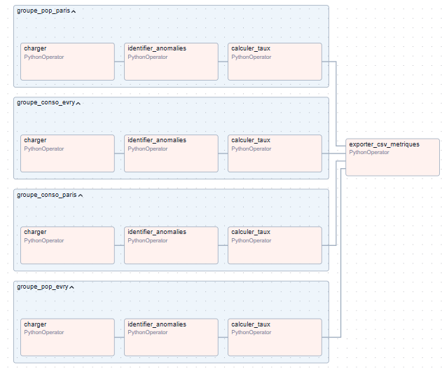
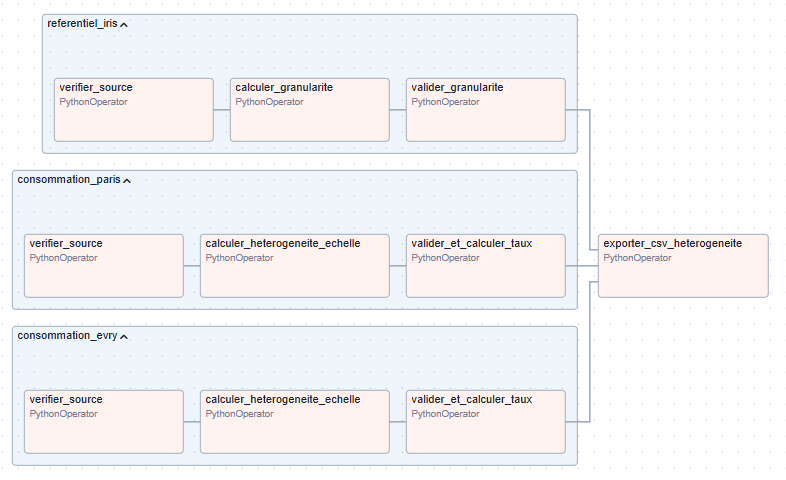
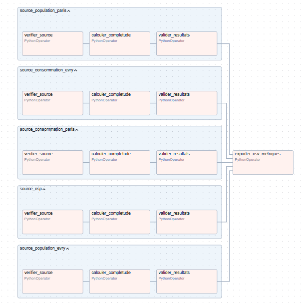
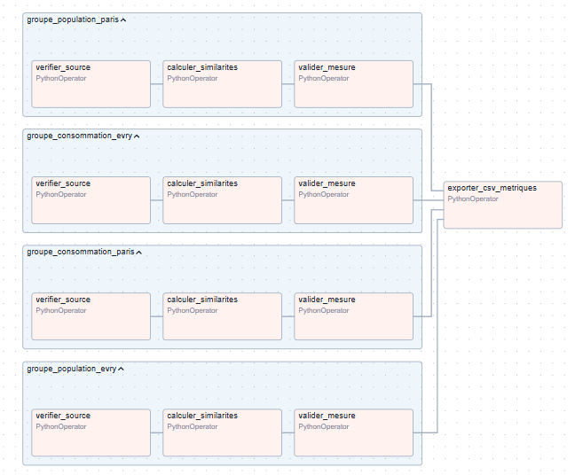
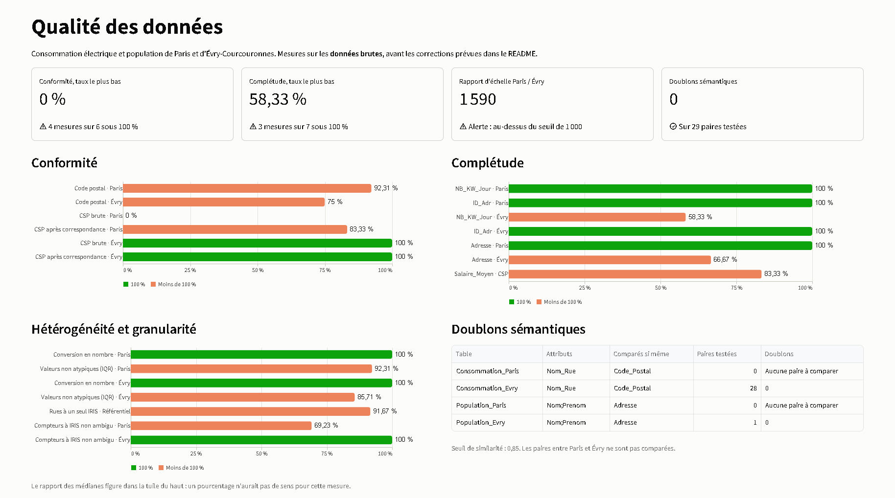

# Rapport de synthèse ETL et audit de qualité des données

**Projet M2 DataScale** : consommation électrique et population de Paris et d'Évry-Courcouronnes.

Ce projet alimente trois tables cibles à partir de six sources, mesure la qualité de ces données et définit, pour chaque mesure, le processus d'amélioration que nous allons appliquer. La cohérence sera évaluée sur ces mêmes données.

Le mapping commence par des **prétraitements**, pour que les tables cibles soient justes : conversion de l'unité de Paris, traduction des CSP de Paris en codes et harmonisation de l'écriture des IRIS. Les requêtes supposent que `NB_KW_Jour` et `Salair_Moyen` sont numériques. La fonction `UNACCENT` nécessite l'extension PostgreSQL du même nom.

Le DAG `etl.py` applique ces prétraitements et ce mapping avec Spark SQL. Il écrit les trois tables dans `dags/data/output/`, avec les mêmes résultats que ces requêtes, arrondis à deux décimales. Les fichiers sources ne sont jamais modifiés : les DAG de mesure de la qualité les auditent tels quels.

## Création des tables cibles

```sql
CREATE EXTENSION IF NOT EXISTS unaccent;

-- Cible 1 : Paris
CREATE TABLE Consommation_IRIS_Paris (
    ID_IRIS VARCHAR(50) PRIMARY KEY,
    Conso_moyenne_annuelle DECIMAL(12, 2)
);

-- Cible 2 : Évry
CREATE TABLE Consommation_IRIS_Evry (
    ID_IRIS VARCHAR(50) PRIMARY KEY,
    Conso_moyenne_annuelle DECIMAL(12, 2)
);

-- Cible 3 : CSP
CREATE TABLE Consommation_CSP (
    ID_CSP VARCHAR(50) PRIMARY KEY,
    Conso_moyenne_annuelle DECIMAL(12, 2),
    Salaire_Moyen DECIMAL(12, 2)
);
```

## Prétraitements

Chaque prétraitement corrige un problème relevé par l'audit, qui empêcherait le mapping de produire des tables cibles justes. Ce sont des vues : les sources restent intactes.

| Prétraitement | Problème corrigé | Effet sur les tables cibles |
|---|---|---|
| `NB_KW_Jour` de Paris divisé par 1 000 | Paris en Wh, Évry en kWh (rapport des médianes : 1 590) | Toutes les consommations sont en kWh |
| CSP de Paris traduites en codes | Libellés (`Cadre`) au lieu des codes du référentiel (`3`) | Les personnes de Paris entrent dans `Consommation_CSP` |
| Une seule écriture par IRIS | `AGUADO` et `Aguado` désignent le même IRIS | Une seule ligne `Aguado` dans `Consommation_IRIS_Evry` |

```sql
-- Paris : de Wh en kWh
CREATE VIEW Consommation_Paris_Prep AS
SELECT ID_Adr, N, Nom_Rue, Code_Postal, NB_KW_Jour / 1000 AS NB_KW_Jour
FROM Consommation_Paris;

-- Paris : libellés de CSP traduits en codes
CREATE TABLE Correspondance_CSP (
    Libelle VARCHAR(100) PRIMARY KEY,
    ID_CSP VARCHAR(50)
);
INSERT INTO Correspondance_CSP VALUES
    ('Agriculteur', '1'),
    ('Commerçant / Artisan', '2'),
    ('Cadre', '3'),
    ('cadres et professions intellectuelles supérieures', '3'),
    ('Professions intermédiaires', '4'),
    ('Employé', '5'),
    ('Ouvrier', '6');

CREATE VIEW Population_Paris_Prep AS
SELECT p.ID_Personne, p.Adresse, t.ID_CSP AS CSP
FROM Population_Paris p
JOIN Correspondance_CSP t ON LOWER(TRIM(p.CSP)) = LOWER(t.Libelle);

-- IRIS : une seule écriture par IRIS (AGUADO et Aguado deviennent Aguado)
CREATE VIEW IRIS_Prep AS
SELECT ID_Rue, ID_Ville,
       MAX(TRIM(ID_IRIS)) OVER (PARTITION BY LOWER(TRIM(ID_IRIS))) AS ID_IRIS
FROM IRIS;
```

Certains problèmes ne sont pas corrigés, faute d'information fiable :

- `Etudiant` et `Retraitée` n'ont pas de code dans `CSP` : ces 2 personnes de Paris sont écartées par la jointure.
- Les consommations et adresses manquantes ne sont pas inventées : `AVG` ignore les valeurs manquantes, et un IRIS sans aucune consommation connue garde une moyenne vide.
- La valeur atypique 548,49 d'Évry est conservée : elle est signalée pour vérification, pas supprimée.
- Les codes postaux invalides n'interviennent dans aucune jointure : ils sont sans effet sur les tables cibles.

## Alimentation de `Consommation_IRIS_Paris`

À Paris, `Nom_Rue` et `ID_Rue` contiennent le même libellé. Le rapprochement se fait sur la rue et sur la ville, car `ID_Ville` contient un nom de ville et non un code postal. La rue Broca est rattachée à deux IRIS, et rien ne permet de savoir dans lequel se trouve chaque compteur : ses compteurs comptent donc à la fois dans `Croulebarbe 7` et dans `Val de Grace 1` (voir l'amélioration de la granularité).

```sql
INSERT INTO Consommation_IRIS_Paris (ID_IRIS, Conso_moyenne_annuelle)
SELECT
    i.ID_IRIS,
    AVG(c.NB_KW_Jour) * 365 AS Conso_moyenne_annuelle
FROM Consommation_Paris_Prep c
JOIN IRIS_Prep i
    ON LOWER(TRIM(c.Nom_Rue)) = LOWER(TRIM(i.ID_Rue))
   AND i.ID_Ville = 'Paris'
GROUP BY i.ID_IRIS;
```

## Alimentation de `Consommation_IRIS_Evry`

À Évry, `Nom_Rue` contient le type de voie (`BOULEVARD AGUADO`) et `ID_Rue` seulement le nom (`aguado`). Le rapprochement compare donc la fin du libellé.

```sql
INSERT INTO Consommation_IRIS_Evry (ID_IRIS, Conso_moyenne_annuelle)
SELECT
    i.ID_IRIS,
    AVG(c.NB_KW_Jour) * 365 AS Conso_moyenne_annuelle
FROM Consommation_Evry c
JOIN IRIS_Prep i
    ON LOWER(TRIM(c.Nom_Rue)) LIKE ('% ' || LOWER(TRIM(i.ID_Rue)))
   AND i.ID_Ville = 'Evry-Courcouronnes'
GROUP BY i.ID_IRIS;
```

## Alimentation de `Consommation_CSP`

`Adresse` étant un texte libre, elle est comparée à l'adresse reconstruite à partir de `N` et `Nom_Rue`, sans tenir compte de la casse, des accents et des espaces. Grâce à la traduction des CSP de Paris, les personnes des deux villes rejoignent le référentiel `CSP`.

```sql
INSERT INTO Consommation_CSP (ID_CSP, Conso_moyenne_annuelle, Salaire_Moyen)
WITH Population_Consommation AS (
    -- Paris : Nom_Rue ne contient pas le type de voie
    SELECT p.CSP, c.NB_KW_Jour
    FROM Population_Paris_Prep p
    JOIN Consommation_Paris_Prep c
      ON REPLACE(LOWER(UNACCENT(p.Adresse)), ' ', '')
       = 'paris,' || c.N || 'rue' || REPLACE(LOWER(UNACCENT(c.Nom_Rue)), ' ', '')
    UNION ALL
    -- Évry : Nom_Rue contient déjà le type de voie
    SELECT p.CSP, c.NB_KW_Jour
    FROM Population_Evry p
    JOIN Consommation_Evry c
      ON REPLACE(LOWER(UNACCENT(p.Adresse)), ' ', '')
       = 'evry-courcouronnes,91000,' || c.N || REPLACE(LOWER(UNACCENT(c.Nom_Rue)), ' ', '')
)
SELECT
    csp.ID_CSP,
    AVG(pc.NB_KW_Jour) * 365 AS Conso_moyenne_annuelle,
    csp.Salair_Moyen AS Salaire_Moyen
FROM Population_Consommation pc
JOIN CSP csp ON LOWER(TRIM(pc.CSP)) = LOWER(TRIM(csp.ID_CSP))
GROUP BY csp.ID_CSP, csp.Salair_Moyen;
```

## Tables cibles obtenues

Consommations moyennes annuelles en kWh, arrondies à deux décimales.

| `Consommation_IRIS_Paris` | | `Consommation_IRIS_Evry` | |
|---|---|---|---|
| Clignancourt 1 | 4 927,71 | Aguado | 3 030,70 |
| Croulebarbe 7 | 5 383,91 | Champs Elysees | 2 717,40 |
| Hopital Saint-Louis 3 | 4 453,68 | Champtier du Coq | 3 214,00 |
| Pere Lachaise 1 | 6 570,25 | Parc aux Lievres | *(aucune consommation connue)* |
| Saint-Georges 7 | 5 110,13 | Pyramides Centre | 7 178,40 |
| Val de Grace 1 | 5 383,91 | | |

| `Consommation_CSP` | Conso moyenne annuelle | Salaire moyen |
|---|---|---|
| 1 | 6 570,19 | 24 780 |
| 2 | 1 825,05 | 24 780 |
| 3 | 54 923,14 | 39 860 |
| 4 | 4 905,22 | 29 720 |
| 5 | 4 207,41 | 24 450 |
| 6 | 7 130,35 | *(manquant dans `CSP`)* |

La CSP 3 est tirée vers le haut par la valeur atypique 548,49 kWh par jour d'Évry, encore à vérifier.

## Contraintes d'intégrité référentielle

Certains liens ne peuvent pas être de vraies clés étrangères SQL, car les valeurs ne sont pas identiques d'une table à l'autre. Ils sont réalisés par les jointures ci-dessus, qui écartent les lignes sans correspondance. C'est le cas des 4 lignes de `Consommation_Evry` situées rue Voltaire et rue Pierre et Marie Curie, absentes de `IRIS`.

**Tables sources et référentiels**

| Attribut | Lien | Type |
|---|---|---|
| `Population_Evry(CSP)` | `CSP(ID_CSP)` | Clé étrangère |
| `Population_Paris(CSP)` | `CSP(ID_CSP)` | Clé étrangère après traduction par `Correspondance_CSP` (libellés dans la source) |
| `Population_Paris(Adresse)` | `Consommation_Paris(N, Nom_Rue)` | Lien logique après normalisation |
| `Population_Evry(Adresse)` | `Consommation_Evry(N, Nom_Rue)` | Lien logique après normalisation |
| `Consommation_Paris(Nom_Rue)` | `IRIS(ID_Rue)`, avec `ID_Ville = 'Paris'` | Lien logique |
| `Consommation_Evry(Nom_Rue)` | `IRIS(ID_Rue)`, avec `ID_Ville = 'Evry-Courcouronnes'` | Lien logique sur la fin du libellé |

**Tables cibles**

| Clé primaire | Valeur issue de |
|---|---|
| `Consommation_IRIS_Paris(ID_IRIS)` | `IRIS(ID_IRIS)` |
| `Consommation_IRIS_Evry(ID_IRIS)` | `IRIS(ID_IRIS)` |
| `Consommation_CSP(ID_CSP)` | `CSP(ID_CSP)` |

## Audit de qualité

### Périmètre d'évaluation

| Facteur | Étape | Attributs ciblés |
|---|---|---|
| Conformité | Source | `Code_Postal` (Paris, Évry), `CSP` (Paris, Évry, par rapport au référentiel) |
| Hétérogénéité des échelles | Source | `NB_KW_Jour` (Paris, Évry) |
| Complétude | Source | `NB_KW_Jour`, `Adresse` et `ID_Adr` (Paris, Évry), `Salair_Moyen` (`CSP`) |
| Doublons sémantiques | Source | `Nom_Rue`, `Nom` et `Prénom` (Paris, Évry) |

### Résultats

Les objectifs sont des propositions.

| Mesure | Paris | Évry | Objectif |
|---|---|---|---|
| Conformité de `Code_Postal` | 92,31 % | 75 % | 100 %, après validation de `91000a` |
| Conformité de `CSP` | 0 % | 100 % | 100 % des libellés reconnus |
| Médiane de `NB_KW_Jour` | 14 000,85 | 8,81 | Rapport (1 590 aujourd'hui) sous le seuil de 1 000 après conversion |
| Valeurs atypiques de `NB_KW_Jour` (IQR) | 1 sur 13 | 1 sur 7 | Chaque cas examiné |
| Complétude de `NB_KW_Jour` | 100 % | 58,33 % | Valeurs manquantes demandées à la source |
| Complétude de `Adresse` | 100 % | 66,67 % | Valeurs manquantes demandées à la source |
| Complétude de `ID_Adr` | 100 % | 100 % | 100 % |
| Complétude de `Salair_Moyen` (table `CSP`, commune aux deux villes) | 83,33 % | 83,33 % | Valeur manquante demandée à la source |
| Doublons dans une même table | 0 | 0 | 0 |
| Identités présentes dans les deux villes | 6 | 6 | Chaque cas examiné |

### Démarche d'amélioration commune

Chaque mesure suit le même cycle :

1. **Mesurer** le niveau de qualité avec la métrique définie.
2. **Analyser** les lignes en erreur pour distinguer une vraie erreur d'une règle mal adaptée.
3. **Corriger** par un prétraitement de l'ETL quand la règle est sûre, sans jamais modifier les fichiers sources. Sinon, demander la correction à la source.
4. **Tracer** chaque correction : table, ligne, valeur d'origine, nouvelle valeur et règle appliquée.
5. **Prévenir** le retour de l'erreur par un contrôle en entrée du pipeline.
6. **Mesurer à nouveau** : relancer l'ETL et les DAG de mesure sur les données corrigées, puis comparer le résultat à l'objectif.

Une valeur n'est corrigée automatiquement que si la règle ne laisse aucun doute. Dans les autres cas, elle est signalée pour validation par le responsable des données.

### 1. Conformité à un format, une codification



**Définition :** vérifie que les données respectent un format prédéfini ou appartiennent à un ensemble de valeurs autorisées.

**Métrique :** taux de conformité, soit le pourcentage de valeurs respectant le format attendu ou présentes dans la table de référence.

**Attributs concernés**

- `Code_Postal` dans `Consommation_Paris` et `Consommation_Evry` : exactement 5 chiffres.
- `CSP` dans `Population_Paris` et `Population_Evry` : doit correspondre à un `ID_CSP` du référentiel `CSP`.

**Constat**

- `Consommation_Paris` contient 1 code postal invalide sur 13 : `750050`.
- `Consommation_Evry` en contient 3 sur 12 : `9100000`, `91000a` et `910000`.
- Dans `Population_Paris`, la CSP est un libellé (`Cadre`, `Employé`...), alors que `CSP.ID_CSP` est un code. Le taux est donc de 0 %.
- `Population_Evry` utilise les codes attendus : 100 % de conformité.

**Comment nous allons améliorer**

1. **Codes postaux :** remplacer la valeur invalide par le code déjà utilisé pour la même rue et la même ville. Par exemple, `750050` (rue Broca) devient `75005`. Sans code de référence fiable, la ligne est signalée : c'est le cas de `91000a` (rue Pablo Picasso), seule ligne de sa rue.
2. **CSP de Paris :** traduire les libellés en codes avec la table `Correspondance_CSP`. Ce prétraitement est appliqué par l'ETL (voir la section Prétraitements).
3. **Libellés sans code :** `Etudiant` et `Retraitée` n'ont aucune catégorie dans le référentiel. Avec la table de correspondance, le taux de Paris passe donc à 83,33 %. Ces libellés restent signalés tant qu'il n'est pas décidé de les exclure ou d'étendre le référentiel, ce qui est nécessaire pour atteindre 100 %.
4. **Prévention :** refuser à l'entrée tout code postal qui ne compte pas 5 chiffres et toute CSP absente du référentiel.

### 2. Hétérogénéité des échelles



**Définition :** détecte les ruptures d'homogénéité dans les unités de mesure, qui faussent les calculs.

**Métrique :** rapport entre les médianes de Paris et d'Évry, avec une alerte au-dessus de 1 000, complété par le nombre de valeurs atypiques dans chaque ville selon la méthode de l'IQR (en dehors de `Q1 - 1,5 × IQR` et `Q3 + 1,5 × IQR`).

**Attribut concerné :** `NB_KW_Jour` dans `Consommation_Paris` et `Consommation_Evry`.

**Constat**

La médiane de `NB_KW_Jour` est de 14 000,85 à Paris contre 8,81 à Évry, soit un **rapport de 1 590**, au-dessus du seuil de 1 000. Cet écart indique une probable confusion entre Wh et kWh, dont le facteur de conversion est de 1 000. L'unité n'étant pas indiquée dans les fichiers, cela reste à confirmer.

La méthode de l'IQR signale une valeur atypique par ville : 5 000,15 à Paris et 548,49 à Évry. Elle compare chaque ville à elle-même et ne peut donc pas révéler l'écart entre les deux.

Le même DAG mesure aussi la granularité de `IRIS` : 1 rue sur 12 (Broca) est rattachée à deux IRIS, ce qui concerne 4 compteurs sur 13 à Paris.

**Comment nous allons améliorer**

1. **Détection :** comparer les médianes des deux villes et signaler tout rapport supérieur à 1 000.
2. **Harmonisation :** diviser les valeurs de Paris par 1 000. Ce prétraitement est appliqué par l'ETL, et la source garde la valeur d'origine.
3. **Prévention :** ajouter l'unité attendue à la description de chaque source et bloquer le chargement si le rapport dépasse le seuil.
4. **Contrôle :** sur les données prétraitées, le rapport des médianes vaut environ 1,59, sous le seuil. `Consommation_CSP` ne mélange plus deux unités. L'audit, lui, mesure toujours la source brute et reste à 1 590 tant que le fournisseur n'a pas corrigé l'unité.

**Comment nous allons améliorer la granularité**

Les 4 compteurs de la rue Broca sont comptés dans deux IRIS, car le nom de la rue ne suffit pas à les départager.

1. **Enrichissement :** ajouter à `IRIS` les colonnes `Num_Debut` et `Num_Fin` pour les rues rattachées à plusieurs IRIS, à partir d'un référentiel officiel.
2. **Jointure :** rattacher chaque compteur par la rue et par son numéro `N`. Les rues sans plage gardent leur seul IRIS.

   ```sql
   JOIN IRIS i
       ON LOWER(TRIM(c.Nom_Rue)) = LOWER(TRIM(i.ID_Rue))
      AND i.ID_Ville = 'Paris'
      AND CAST(c.N AS INT) BETWEEN COALESCE(i.Num_Debut, 0)
                               AND COALESCE(i.Num_Fin, 99999)
   ```

3. **Contrôle :** relancer l'ETL et le DAG. Aucun compteur ne doit plus correspondre à plus d'un IRIS.

### 3. Complétude des données



**Définition :** évalue la proportion de données manquantes par rapport au volume nécessaire aux calculs cibles.

**Métrique :** taux de complétude par attribut clé, soit la part des lignes dont la valeur est renseignée. Une valeur nulle, vide, `nan`, `null` ou `none` compte comme manquante.

**Attributs concernés**

- `NB_KW_Jour` dans `Consommation_Paris` et `Consommation_Evry` : sans cette mesure, la ligne ne peut pas contribuer à `Conso_moyenne_annuelle`.
- `Adresse` dans `Population_Paris` et `Population_Evry`, et `ID_Adr` dans `Consommation_Paris` et `Consommation_Evry` : ils identifient l'adresse de la personne et du compteur. Sans adresse, une personne ne peut pas être rattachée à une consommation pour `Consommation_CSP`.
- `Salair_Moyen` dans `CSP` : il alimente `Salaire_Moyen` dans `Consommation_CSP`.

**Constat**

- `NB_KW_Jour` manque sur 5 lignes sur 12 dans `Consommation_Evry`.
- `Adresse` manque sur 4 lignes sur 12 dans `Population_Evry`.
- `Salair_Moyen` manque sur 1 ligne sur 6 dans `CSP` : la CSP 6 (`Ouvriers / ouvrières`).

**Comment nous allons améliorer**

1. **Source :** transmettre la liste des lignes incomplètes au fournisseur des données, car c'est le seul moyen de retrouver les vraies valeurs.
2. **Consommations manquantes :** les laisser à `NULL`, sans les remplacer par 0, ce qui ferait baisser artificiellement les moyennes. Une estimation par la médiane de la rue ou de l'IRIS ne serait utilisée qu'avec validation, et serait marquée comme estimée.
3. **Adresses manquantes :** ne pas les deviner. Les personnes concernées sont exclues de la jointure et comptées à part.
4. **Transparence :** indiquer avec chaque moyenne le nombre de valeurs utilisées et le nombre de valeurs exclues.
5. **Prévention :** déclencher une alerte si le taux de complétude d'un attribut clé passe sous un seuil à fixer.

### 4. Détection et élimination des doublons sémantiques



**Définition :** identifie des enregistrements qui représentent la même entité réelle malgré des différences d'écriture (fautes de frappe, abréviations, variations de format).

**Métrique :** nombre de paires dont la similarité de Levenshtein (fonction `levenshtein` de Spark SQL), calculée sur les valeurs brutes, dépasse strictement 0,85, rapporté au nombre de paires testées.

**Attributs concernés**

- `Nom_Rue` dans `Consommation_Paris` et `Consommation_Evry`. Exemple : `Rue de la Paix`, `R. de la Paix` et `Rue de lapaix`.
- `Nom` et `Prénom` dans `Population_Paris` et `Population_Evry`. Exemple : `Dupont Jean` et `Dupond Jean`.

**Constat**

- Aucune paire ne dépasse le seuil de similarité de 0,85 à l'intérieur d'une même table.
- Le contrôle compare les valeurs telles quelles, sans normalisation : une différence de casse ou d'accent compte donc comme une erreur de frappe. Les rues ne sont comparées qu'à code postal identique (28 paires à Évry, aucune à Paris) et les identités qu'à adresse strictement identique (1 paire à Évry, aucune à Paris, où les adresses sont écrites différemment). Le résultat reste le même en comparant toutes les paires de chaque table.
- Six identités figurent à la fois dans `Population_Paris` et `Population_Evry` : Bernard Sophie, Dubois Karim, Dupont Julien, Lefèvre Amélie, Martin Claire et Moreau Thomas. Leurs CSP concordent une fois les libellés de Paris convertis. Cinq ont des adresses différentes, et celle de Martin Claire est absente à Évry : la comparaison est donc impossible pour cette personne.

Il peut s'agir de doublons, d'homonymes ou de personnes ayant déménagé. Le contrôle actuel ne compare pas les deux villes et ne peut donc pas les repérer.

**Comment nous allons améliorer**

1. **Comparaison :** normaliser les valeurs (casse, accents, abréviations de voies), puis étendre le contrôle aux paires entre les deux tables, sans exiger une adresse identique, en gardant le seuil de 0,85.
2. **Qualification :** classer chaque paire à l'aide des attributs disponibles : similarité du nom, CSP et adresse.
3. **Décision :** faire valider chaque paire. Un même nom ne suffit pas à fusionner deux personnes.
4. **Élimination :** pour un doublon confirmé, garder un seul enregistrement de référence et conserver le lien vers les identifiants d'origine.
5. **Prévention :** rejouer ce contrôle à chaque nouveau chargement, et ajouter un identifiant de personne commun aux deux sources si c'est possible.

## Tableau de bord

Le tableau de bord affiche les métriques produites par les DAG, sans les recalculer. Chaque DAG écrit son CSV dans `dags/data/output/audit_results/` (dossier ignoré par Git) :

| DAG | Fichier produit |
|---|---|
| `mesure_conformite` | `conformite/audit_conformite.csv` |
| `metrique_completude` | `completude/audit_completude.csv` |
| `mesure_heterogeneite_granularite` | `heterogeneite/audit_heterogeneite.csv` |
| `metrique_doublons_semantiques` | `doublons/audit_doublons.csv` |

Si un fichier n'y figure pas, le tableau de bord cherche une copie à la racine du projet. Il indique en bas de page les fichiers lus et leur date, et signale ceux qui manquent.



Pour le lancer depuis la racine du projet :

```bash
pip install -r dashboard/requirements.txt
python -m streamlit run dashboard/app.py
```

La page s'ouvre sur `http://localhost:8501`. Après une nouvelle exécution des DAG, il suffit de la recharger.
